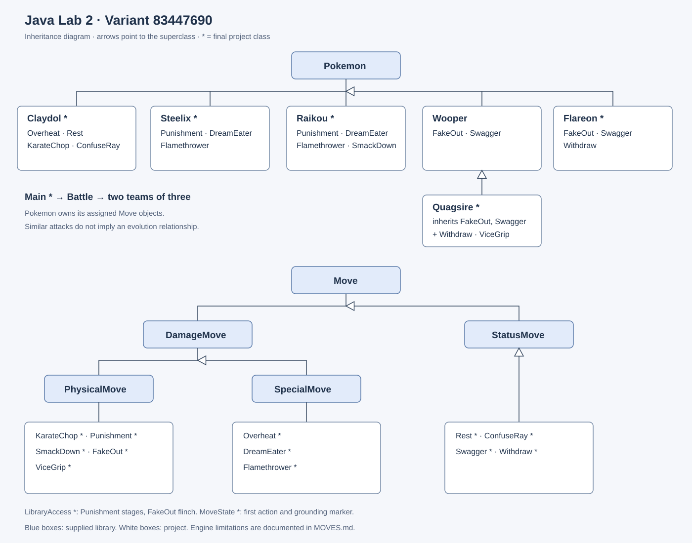
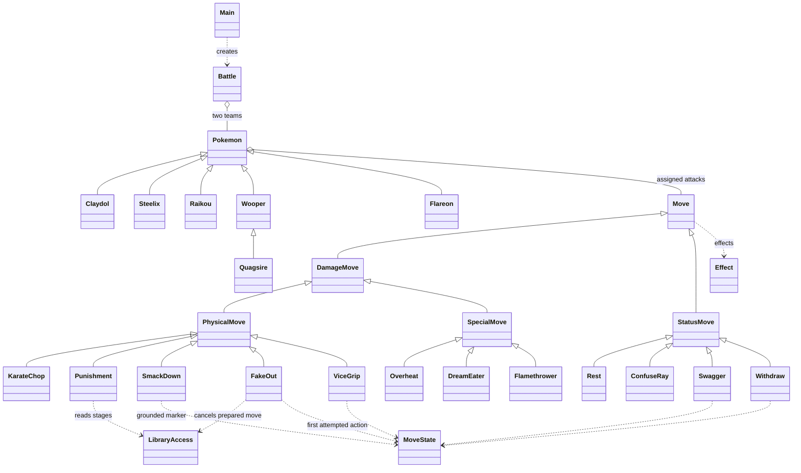

# Class diagram — variant 83447690

All project leaf classes are final; only Wooper is extensible because Quagsire inherits it.
Library base classes are unchanged. Leaf annotations are summarized here instead of altering their displayed names.

